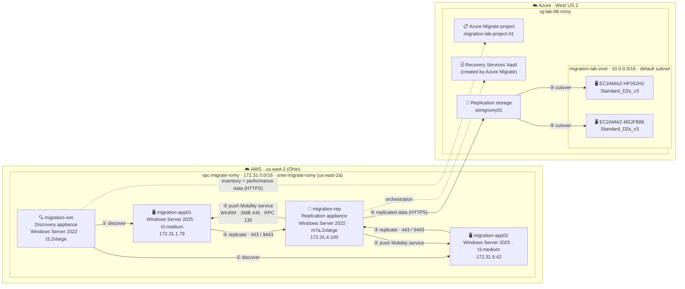
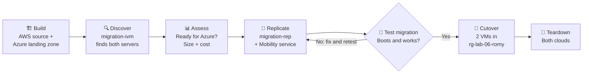
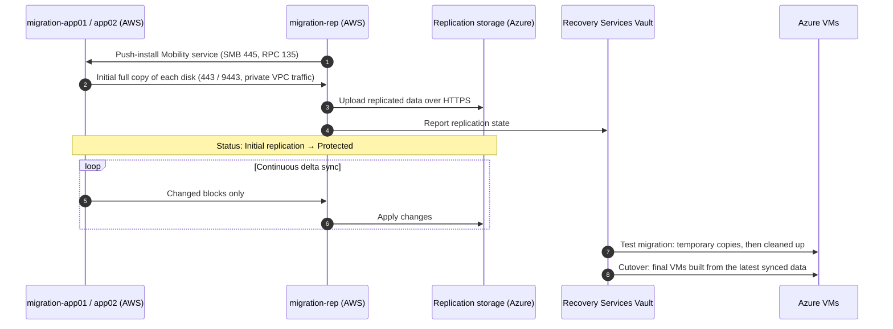

# Cloud-to-Cloud Migration: AWS EC2 to Azure with Azure Migrate


> Moving **two running Windows servers** from **AWS EC2** into **Azure** the way real migration projects do it: **discover** the servers, **assess** whether they're ready, **replicate** their disks continuously, **test** the copies in isolation, then **cut over**. Built first by hand in the **AWS console** and **Azure portal**, then codified in **Terraform** so the whole environment can be rebuilt.

**Author:** Romy Francis ([@R-Cipher](https://github.com/R-Cipher) · [LinkedIn](https://www.linkedin.com/in/romy-francis))

---

## Watch me walkthrough this lab!
> https://www.loom.com/share/b47c5b4053ac4bdaa867b72f711174d4
---

## At a Glance

| | |
|---|---|
| **What I built** | Two Windows Server 2025 instances on AWS, two Azure Migrate appliances running alongside them, and a full migration that moved **both servers** into Azure: discovery, assessment, replication, test migration, and cutover |
| **Clouds and services** | **AWS:** VPC, EC2, Security Groups · **Azure:** Azure Migrate, Azure Site Recovery (under the hood), Recovery Services Vault, Storage, Key Vault, Virtual Network, Virtual Machines |
| **Tooling** | AWS Management Console, Azure portal, Terraform (AWS + AzureRM providers) |
| **Skills demonstrated** | Multi-cloud IaC, migration planning, readiness assessment and right-sizing, agent-based replication, least-privilege security group design, test-before-cutover discipline, cross-cloud networking, clean teardown |
| **Regions** | AWS `us-east-2` (Ohio) → Azure **West US 2** |
| **Assessment** | **2 of 2 servers Ready for Azure** · estimated **$79.17/month** for both |
| **Result** | `migration-app01` and `migration-app02` now run in Azure as `Standard_D2s_v3` VMs |

---

## Table of Contents

1. [Objective](#1-objective)
2. [Why Cloud Migrations Matter](#2-why-cloud-migrations-matter)
3. [Architecture](#3-architecture)
4. [Key Concepts](#4-key-concepts)
5. [Design Decisions](#5-design-decisions)
6. [Prerequisites](#6-prerequisites)
7. [Environment and Naming](#7-environment-and-naming)
8. [Infrastructure as Code (Terraform)](#8-infrastructure-as-code-terraform)
9. [Deployment Steps](#9-deployment-steps)
10. [Validation](#10-validation)
11. [Troubleshooting](#11-troubleshooting)
12. [Clean Up](#12-clean-up)
13. [Key Takeaways and Next Steps](#13-key-takeaways-and-next-steps)

---

## 1. Objective

Migrate two Windows servers from AWS to Azure, end to end, using Microsoft's native migration service.

| Phase | Question it answers | What happens |
|---|---|---|
| **Build** | What are we moving, and where to? | Two source servers in AWS; a landing zone in Azure |
| **Discover** | What's running over there? | A discovery appliance in AWS inventories both servers |
| **Assess** | Are they ready, and what will they cost? | Azure Migrate checks compatibility and recommends VM sizes |
| **Replicate** | How do we copy them without downtime? | A replication appliance continuously syncs both disks to Azure |
| **Test** | Will they actually boot in Azure? | Throwaway copies are started and checked |
| **Cut over** | Make it real | Azure builds the final VMs from the latest synced disks |

**By the end of this lab:**

- Two Windows Server 2025 instances run in an AWS VPC
- An Azure Migrate project tracks both servers through every phase
- The assessment reports **both servers Ready for Azure**, at an estimated **$79.17/month** combined
- Both servers replicate to Azure and pass a test migration
- Cutover produces **two running Azure VMs**: `EC2AMAZ-HP262H2` and `EC2AMAZ-M3JFB86`
- Both clouds are cleaned up at the end

---

## 2. Why Cloud Migrations Matter

Companies move workloads between clouds all the time: to cut costs, meet compliance requirements, consolidate onto one platform, or absorb an acquired company that runs on a different provider.

Moving a server isn't just copying a disk. A migration that works in production has to answer:

- **Will it boot?** Drivers, boot type, and OS version all have to be supported on the new platform.
- **What size should it be?** Copying the old instance size 1:1 often wastes money.
- **How long will it be down?** Copying a disk while users are working means changes keep happening.
- **Can we back out?** If the new VM doesn't work, the old one has to still be there.

Azure Migrate answers each question with a phase: **assessment** covers boot and size, **continuous replication** keeps downtime short, and **test migration** proves the result before anyone commits.

---

## 3. Architecture

### Component view



**How to read it:** the **numbered arrows** are the migration in order. Both appliances live **in AWS, next to the servers they serve**, which is Microsoft's recommended pattern for AWS sources. Server-to-appliance traffic stays private inside the VPC. Only the appliances talk to Azure, outbound over HTTPS.

### The journey, phase by phase



### Replication: what actually moves the data



---

## 4. Key Concepts

| Concept | Plain-English explanation |
|---|---|
| **Azure Migrate project** | The central hub. It tracks discovered servers, stores assessments, and records replication and cutover history. |
| **Discovery appliance** | A Windows server running Microsoft's appliance software. It connects to the source servers with OS credentials and reports inventory and performance data to Azure. |
| **Replication appliance** | A **separate** Windows server that does the copying. It runs Azure Site Recovery components (configuration and process server). The discovery appliance can't replicate. |
| **Mobility service** | A small agent installed on each source server. It captures disk writes and sends them to the replication appliance. The appliance push-installs it with the server's admin credentials. |
| **Agent-based vs agentless** | Agentless replication is only for VMware and Hyper-V sources, where the hypervisor exposes disks. AWS instances are migrated **as physical servers**, which is **agent-based**: the Mobility service runs on each source. |
| **Assessment** | Readiness check (OS, boot type, disks, network) plus a right-sized VM recommendation and a monthly cost estimate. |
| **Performance-based sizing** | Sizes the Azure VM from the CPU and memory the server **actually uses**, not from what it was given on AWS. |
| **Recovery Services Vault** | Where Site Recovery keeps the replication configuration, policy, and state. Azure Migrate created it automatically. |
| **Test migration** | Starts a temporary VM from the replicated data without affecting replication or the source. Prove it boots, then clean it up. |
| **Cutover** | The real migration: Azure creates the final VM from the most recent synced data. |

### Two appliances, two jobs

| | Discovery appliance (`migration-ivm`) | Replication appliance (`migration-rep`) |
|---|---|---|
| **Job** | Find and measure the servers | Copy the servers' disks to Azure |
| **Instance** | `t3.2xlarge`, Windows Server 2022 | `m7a.2xlarge`, Windows Server 2022 |
| **Installer** | `AzureMigrateInstaller.ps1` | `DRInstaller.ps1` |
| **Registers with** | Azure Migrate project (project key) | Recovery Services Vault |
| **Used in phases** | Discover, Assess | Replicate, Test, Cutover |

### Sizing requirements (Microsoft docs)

| Role | Microsoft minimum | This lab | Meets it? |
|---|---|---|---|
| **Source servers** (Windows Server 2025) | 2 GB RAM (4 GB recommended), 32 GB disk ([Windows Server hardware requirements](https://learn.microsoft.com/windows-server/get-started/hardware-requirements)) | `t3.medium`: 2 vCPU, **4 GB** | ✅ |
| **Discovery appliance** | 8 vCPUs, 16 GB RAM, ~80 GB disk, Windows Server 2019/2022 ([Discover AWS instances](https://learn.microsoft.com/azure/migrate/tutorial-discover-aws)) | `t3.2xlarge`: **8 vCPU, 32 GB**, Windows Server 2022 | ✅ |
| **Replication appliance** | 8 cores, 16 GB RAM, two disks: OS + cache/data ([Site Recovery support matrix](https://learn.microsoft.com/azure/site-recovery/vmware-physical-azure-support-matrix), [replication appliance](https://learn.microsoft.com/azure/migrate/migrate-replication-appliance)) | `m7a.2xlarge`: **8 vCPU, 32 GB**, Windows Server 2022 | ✅ |

The Terraform version checks these minimums automatically at `plan` time. Microsoft's replication appliance page lists a **600 GB** cache disk, which the Terraform version adds as a second EBS volume.

---

## 5. Design Decisions

| Decision | Why | Production alternative |
|---|---|---|
| **Built by hand first, then in Terraform** | The console and portal made each step concrete; Terraform makes the environment repeatable | Terraform only, with remote state and CI/CD |
| **Appliances in AWS, next to the sources** | Discovery and replication traffic stays private inside the VPC; Terraform also assigns public IPs to the source instances | Same pattern, plus a site-to-site VPN or ExpressRoute for the Azure side |
| **Separate security group per role** | Source servers, the discovery appliance, and the replication appliance each get only the ports they need | Same, managed as code with change review |
| **Source management ports scoped to one `/32`** | WinRM, SMB, and RPC on the sources only accept the replication appliance (`172.31.4.100/32`) | Same, plus Windows Firewall rules on the guest |
| **Replication ports scoped to the two sources** | 443 and 9443 on the appliances only accept `172.31.1.79/32` and `172.31.9.42/32` | Same |
| **Non-overlapping address spaces** (172.31.0.0/16 vs 10.0.0.0/16) | Allows a VPN or peering between clouds later without readdressing | Plan an enterprise IP scheme up front |
| **One Azure resource group** (`rg-lab-06-romy`) | Simple to review and delete in one step | Separate RGs for migration tooling and the landing zone |
| **`Standard_D2s_v3` targets** | 2 vCPU / 8 GB matches the `t3.medium` sources, and it's the size available in my subscription | Accept the assessment's performance-based recommendation |
| **Test migration before cutover** | Proves each VM boots before committing | Mandatory, with application owners signing off |

---

## 6. Prerequisites

- An **Azure subscription** where I'm Owner (or Contributor + User Access Administrator)
- An **AWS account** with permission to create VPC resources, security groups, key pairs, and EC2 instances
- An **RDP client**: Windows App / Microsoft Remote Desktop on macOS, or `mstsc` on Windows
- Regional **vCPU quota** in AWS for two 8-vCPU appliance instances
- Basic comfort with Windows Server, RDP, and security groups

### Cost

The two 8-vCPU appliance instances are the biggest cost in this lab, followed by the Azure VMs after cutover. To keep the bill small:

- **Stop** the EC2 instances between sessions (EBS storage still bills, compute doesn't)
- Run the migration in one sitting where possible
- Clean up both clouds as soon as the video is recorded

Check the [Azure pricing calculator](https://azure.microsoft.com/pricing/calculator/) and [EC2 pricing](https://aws.amazon.com/ec2/pricing/on-demand/) for current rates.

---

## 7. Environment and Naming

### AWS (`us-east-2`, Ohio)

| Resource | Name | Details |
|---|---|---|
| VPC | `vpc-migrate-romy` | `172.31.0.0/16` |
| Subnet | `snet-migrate-romy` | Availability Zone `us-east-2a` |
| Source server 1 | `migration-app01` | Windows Server 2025, `t3.medium`, `172.31.1.79` |
| Source server 2 | `migration-app02` | Windows Server 2025, `t3.medium`, `172.31.9.42` |
| Discovery appliance | `migration-ivm` | Windows Server 2022, `t3.2xlarge` |
| Replication appliance | `migration-rep` | Windows Server 2022, `m7a.2xlarge`, `172.31.4.100` |
| Security groups | `launch-wizard-1`, `-2`, `-3` | One per role (see below) |

### Security group rules

**Source servers** (`launch-wizard-2`): management ports open **only to the replication appliance**

| Port | Protocol | Purpose | Source |
|---|---|---|---|
| 5985 | TCP | WinRM (HTTP) | `172.31.4.100/32` |
| 5986 | TCP | WinRM (HTTPS) | `172.31.4.100/32` |
| 445 | TCP | SMB, used to push the Mobility service | `172.31.4.100/32` |
| 135 | TCP | RPC/WMI, used to push the Mobility service | `172.31.4.100/32` |
| 3389 | TCP | RDP for administration | My public IP (`/32`) |

**Discovery appliance** (`launch-wizard-1`) and **replication appliance** (`launch-wizard-3`): replication traffic **only from the two sources**

| Port | Protocol | Purpose | Source |
|---|---|---|---|
| 443 | TCP | HTTPS (replication management) | `172.31.1.79/32`, `172.31.9.42/32` |
| 9443 | TCP | Replication data from the Mobility service | `172.31.1.79/32`, `172.31.9.42/32` |
| 3389 | TCP | RDP for administration | `0.0.0.0/0` (hand-built lab; the Terraform version restricts it to your IP) |

### Azure (West US 2)

| Resource | Name | Created by |
|---|---|---|
| Resource group | `rg-lab-06-romy` | Me |
| Azure Migrate project | `migration-lab-project-01` | Me |
| Assessment | `migration-assessment` | Me |
| Virtual network | `migration-lab-vnet` (`10.0.0.0/16`, subnet `default`) | Me |
| Replication storage account | `stmigromy01` (Standard LRS) | Me |
| Recovery Services Vault | `migration-lab-project-01-MigrateVault-…` | Azure Migrate |
| Key vault | `migration-lab-2042kv` | Azure Migrate |
| Extra storage account | `migratecee5dlsa…` | Azure Migrate |
| Migrated VM (from `migration-app01`) | `EC2AMAZ-HP262H2` | Cutover |
| Migrated VM (from `migration-app02`) | `EC2AMAZ-M3JFB86` | Cutover |

> 💡 The migrated VMs keep the **Windows hostnames** the servers had on AWS (`EC2AMAZ-…`), not the EC2 Name tags. That's a quick visual proof that these are the same machines, not new builds.

---

## 8. Infrastructure as Code (Terraform)

I first built this lab by hand. This section rebuilds the **same infrastructure** in both clouds with Terraform: same names, regions, instance types, AMIs, private IPs, and security group rules.

### What Terraform builds, and what stays in the portal

| Phase | Terraform | Portal (interactive) |
|---|---|---|
| Build: AWS source | ✅ VPC tags, subnet, 3 security groups, 2 source instances | Key pairs (created once, beforehand) |
| Build: Azure landing zone | ✅ Resource group, VNet, storage account | Azure Migrate project |
| Discover | ✅ `migration-ivm` instance | Appliance install, project key, credentials, discovery |
| Assess | n/a | Assessment |
| Replicate | ✅ `migration-rep` instance | Appliance install, vault registration, Replicate wizard |
| Test + cutover | n/a | Test migration, Migrate, Complete migration |

The remaining steps stay manual on purpose. The appliances need software installed and registered with a one-time key, and the AzureRM provider has no resources for Azure Migrate projects, assessments, or replication. Azure Migrate also creates its own vault, key vault, and storage account, so Terraform doesn't define those.

### Folder structure

```
.
├── aws-side/
│   ├── main.tf
│   ├── variables.tf
│   ├── outputs.tf
│   ├── terraform.tfvars.example # tracked template
│   └── terraform.tfvars        # git-ignored
└── azure-side/
    ├── main.tf
    ├── variables.tf
    └── outputs.tf
```

Two separate roots, so each cloud can be planned, applied, and destroyed independently.

> 🔐 `terraform.tfvars` is git-ignored; the `.example` template is safe to track. Keep personal values out of the example.

### AWS side

<details>
<summary><b>aws-side/variables.tf</b></summary>

```hcl
variable "aws_region" {
  description = "AWS region for the source environment."
  type        = string
  default     = "us-east-2"
}

variable "availability_zone" {
  description = "Availability Zone for the subnet and all instances."
  type        = string
  default     = "us-east-2a"
}

variable "admin_cidr" {
  description = "Your public IP in CIDR form (for example YOUR_PUBLIC_IP/32). The only address allowed to RDP."
  type        = string
}

variable "migration_key_name" {
  description = "Existing EC2 key pair used by the discovery appliance."
  type        = string
  default     = "migrationKey"
}

variable "appliance_key_name" {
  description = "Existing EC2 key pair used by the source servers and the replication appliance."
  type        = string
  default     = "applianceKey"
}

# Instance sizes. Terraform checks each one against Microsoft's minimums
# (see "Sizing requirements") and stops at plan time if it's too small.
variable "source_instance_type" {
  description = "Source servers. Windows Server 2025 needs at least 2 GB RAM."
  type        = string
  default     = "t3.medium" # 2 vCPU, 4 GB
}

variable "discovery_instance_type" {
  description = "Discovery appliance. Needs at least 8 vCPUs and 16 GB RAM."
  type        = string
  default     = "t3.2xlarge" # 8 vCPU, 32 GB
}

variable "replication_instance_type" {
  description = "Replication appliance. Needs at least 8 vCPUs and 16 GB RAM."
  type        = string
  default     = "m7a.2xlarge" # 8 vCPU, 32 GB
}

variable "replication_cache_disk_gb" {
  description = "Second (cache) disk for the replication appliance."
  type        = number
  default     = 600
}
```
</details>

<details>
<summary><b>aws-side/main.tf</b></summary>

```hcl
terraform {
  required_version = ">= 1.6"

  required_providers {
    aws = {
      source  = "hashicorp/aws"
      version = "~> 6.0"
    }
  }
}

provider "aws" {
  region = var.aws_region
}

# ---------------------------------------------------------------------------
# Fixed private IPs. The security group rules reference each other's IPs,
# so pinning them avoids a dependency loop and matches the lab exactly.
# ---------------------------------------------------------------------------
locals {
  ip = {
    app01 = "172.31.1.79"
    app02 = "172.31.9.42"
    ivm   = "172.31.11.59"
    rep   = "172.31.4.100"
  }

  source_servers = {
    "migration-app01" = local.ip.app01
    "migration-app02" = local.ip.app02
  }

  # Ports the replication appliance uses to reach the source servers
  source_mgmt_ports = {
    winrm-http  = 5985
    winrm-https = 5986
    smb         = 445
    rpc         = 135
  }

  # Minimums from Microsoft docs (memory in MiB, disk in GB)
  min = {
    source      = { memory_mib = 2048, os_disk_gb = 32 }             # Windows Server 2025
    discovery   = { vcpus = 8, memory_mib = 16384, os_disk_gb = 80 } # Azure Migrate appliance
    replication = { vcpus = 8, memory_mib = 16384 }                  # Replication appliance
  }

  # 443 and 9443 from each source server, as one rule per port per IP
  replication_rules = {
    for pair in setproduct([443, 9443], [local.ip.app01, local.ip.app02]) :
    "${pair[0]}-${pair[1]}" => { port = pair[0], cidr = "${pair[1]}/32" }
  }
}

# ---------------------------------------------------------------------------
# Network: the region's default VPC (172.31.0.0/16) and its us-east-2a subnet.
# Terraform adopts and tags them; destroy only removes them from state.
# ---------------------------------------------------------------------------
resource "aws_default_vpc" "main" {
  tags = {
    Name = "vpc-migrate-romy"
  }
}

resource "aws_default_subnet" "main" {
  availability_zone = var.availability_zone

  tags = {
    Name = "snet-migrate-romy"
  }
}

# ---------------------------------------------------------------------------
# AMIs: latest Amazon-published Windows Server images
# ---------------------------------------------------------------------------
data "aws_ami" "windows_2025" {
  most_recent = true
  owners      = ["amazon"]

  filter {
    name   = "name"
    values = ["Windows_Server-2025-English-Full-Base-*"]
  }
}

data "aws_ami" "windows_2022" {
  most_recent = true
  owners      = ["amazon"]

  filter {
    name   = "name"
    values = ["Windows_Server-2022-English-Full-Base-*"]
  }
}

# Instance type specs, used to check the sizing minimums
data "aws_ec2_instance_type" "source" {
  instance_type = var.source_instance_type
}

data "aws_ec2_instance_type" "discovery" {
  instance_type = var.discovery_instance_type
}

data "aws_ec2_instance_type" "replication" {
  instance_type = var.replication_instance_type
}

# ---------------------------------------------------------------------------
# Security groups: one per role. (AWS reserves the "sg-" name prefix.)
# ---------------------------------------------------------------------------
resource "aws_security_group" "sources" {
  name        = "migrate-sources-sg"
  description = "Source servers: management from the replication appliance, RDP from admin"
  vpc_id      = aws_default_vpc.main.id
  tags        = { Name = "migrate-sources-sg" }
}

resource "aws_security_group" "discovery" {
  name        = "migrate-discovery-sg"
  description = "Discovery appliance: 443/9443 from source servers, RDP from admin"
  vpc_id      = aws_default_vpc.main.id
  tags        = { Name = "migrate-discovery-sg" }
}

resource "aws_security_group" "replication" {
  name        = "migrate-replication-sg"
  description = "Replication appliance: 443/9443 from source servers, RDP from admin"
  vpc_id      = aws_default_vpc.main.id
  tags        = { Name = "migrate-replication-sg" }
}

# Source servers: WinRM, SMB, RPC only from the replication appliance
resource "aws_vpc_security_group_ingress_rule" "sources_mgmt" {
  for_each = local.source_mgmt_ports

  security_group_id = aws_security_group.sources.id
  description       = "${each.key} from replication appliance"
  ip_protocol       = "tcp"
  from_port         = each.value
  to_port           = each.value
  cidr_ipv4         = "${local.ip.rep}/32"
}

# Appliances: HTTPS (443) and replication data (9443) only from the two sources
resource "aws_vpc_security_group_ingress_rule" "discovery_replication" {
  for_each = local.replication_rules

  security_group_id = aws_security_group.discovery.id
  description       = "${each.value.port} from source server"
  ip_protocol       = "tcp"
  from_port         = each.value.port
  to_port           = each.value.port
  cidr_ipv4         = each.value.cidr
}

resource "aws_vpc_security_group_ingress_rule" "replication_replication" {
  for_each = local.replication_rules

  security_group_id = aws_security_group.replication.id
  description       = "${each.value.port} from source server"
  ip_protocol       = "tcp"
  from_port         = each.value.port
  to_port           = each.value.port
  cidr_ipv4         = each.value.cidr
}

# RDP from the admin IP on every security group
resource "aws_vpc_security_group_ingress_rule" "rdp" {
  for_each = {
    sources     = aws_security_group.sources.id
    discovery   = aws_security_group.discovery.id
    replication = aws_security_group.replication.id
  }

  security_group_id = each.value
  description       = "RDP from admin"
  ip_protocol       = "tcp"
  from_port         = 3389
  to_port           = 3389
  cidr_ipv4         = var.admin_cidr
}

# All outbound (Terraform removes the default egress rule, so add it back).
# The appliances need outbound 443 to reach Azure.
resource "aws_vpc_security_group_egress_rule" "all" {
  for_each = {
    sources     = aws_security_group.sources.id
    discovery   = aws_security_group.discovery.id
    replication = aws_security_group.replication.id
  }

  security_group_id = each.value
  description       = "All outbound"
  ip_protocol       = "-1"
  cidr_ipv4         = "0.0.0.0/0"
}

# ---------------------------------------------------------------------------
# Instances
# ---------------------------------------------------------------------------
resource "aws_instance" "source" {
  for_each = local.source_servers

  ami                         = data.aws_ami.windows_2025.id
  instance_type               = var.source_instance_type
  subnet_id                   = aws_default_subnet.main.id
  private_ip                  = each.value
  associate_public_ip_address = true
  vpc_security_group_ids      = [aws_security_group.sources.id]
  key_name                    = var.appliance_key_name

  root_block_device {
    volume_type = "gp3"
    volume_size = local.min.source.os_disk_gb
  }

  lifecycle {
    precondition {
      condition     = data.aws_ec2_instance_type.source.memory_size >= local.min.source.memory_mib
      error_message = "Source servers need at least 2 GB RAM (Windows Server 2025 minimum)."
    }
  }

  tags = { Name = each.key }
}

resource "aws_instance" "discovery" {
  ami                         = data.aws_ami.windows_2022.id
  instance_type               = var.discovery_instance_type
  subnet_id                   = aws_default_subnet.main.id
  private_ip                  = local.ip.ivm
  associate_public_ip_address = true
  vpc_security_group_ids      = [aws_security_group.discovery.id]
  key_name                    = var.migration_key_name

  root_block_device {
    volume_type = "gp3"
    volume_size = local.min.discovery.os_disk_gb
  }

  lifecycle {
    precondition {
      condition = (
        data.aws_ec2_instance_type.discovery.default_vcpus >= local.min.discovery.vcpus &&
        data.aws_ec2_instance_type.discovery.memory_size >= local.min.discovery.memory_mib
      )
      error_message = "The discovery appliance needs at least 8 vCPUs and 16 GB RAM."
    }
  }

  tags = { Name = "migration-ivm" }
}

resource "aws_instance" "replication" {
  ami                         = data.aws_ami.windows_2022.id
  instance_type               = var.replication_instance_type
  subnet_id                   = aws_default_subnet.main.id
  private_ip                  = local.ip.rep
  associate_public_ip_address = true
  vpc_security_group_ids      = [aws_security_group.replication.id]
  key_name                    = var.appliance_key_name

  # OS disk. 80 GB is headroom for a 32 GB-RAM server, not a documented minimum.
  root_block_device {
    volume_type = "gp3"
    volume_size = 80
  }

  lifecycle {
    precondition {
      condition = (
        data.aws_ec2_instance_type.replication.default_vcpus >= local.min.replication.vcpus &&
        data.aws_ec2_instance_type.replication.memory_size >= local.min.replication.memory_mib
      )
      error_message = "The replication appliance needs at least 8 vCPUs and 16 GB RAM."
    }
  }

  tags = { Name = "migration-rep" }
}

# Second disk: the replication appliance needs an OS disk plus a cache/data disk
resource "aws_ebs_volume" "replication_cache" {
  availability_zone = var.availability_zone
  size              = var.replication_cache_disk_gb
  type              = "gp3"

  tags = { Name = "migration-rep-cache" }
}

resource "aws_volume_attachment" "replication_cache" {
  device_name = "xvdf"
  volume_id   = aws_ebs_volume.replication_cache.id
  instance_id = aws_instance.replication.id
}
```
</details>

<details>
<summary><b>aws-side/outputs.tf</b></summary>

```hcl
output "source_servers" {
  description = "Source servers: name => private / public IP"
  value = {
    for name, inst in aws_instance.source :
    name => { private_ip = inst.private_ip, public_ip = inst.public_ip }
  }
}

output "discovery_appliance" {
  value = {
    private_ip = aws_instance.discovery.private_ip
    public_ip  = aws_instance.discovery.public_ip
  }
}

output "replication_appliance" {
  value = {
    private_ip = aws_instance.replication.private_ip
    public_ip  = aws_instance.replication.public_ip
  }
}
```
</details>

<details>
<summary><b>aws-side/terraform.tfvars.example</b> (tracked template)</summary>

```hcl
admin_cidr = "YOUR_PUBLIC_IP/32"
```
</details>

### Azure side

<details>
<summary><b>azure-side/variables.tf</b></summary>

```hcl
variable "location" {
  description = "Azure region for the landing zone."
  type        = string
  default     = "westus2"
}

variable "resource_group_name" {
  type    = string
  default = "rg-lab-06-romy"
}
```
</details>

<details>
<summary><b>azure-side/main.tf</b></summary>

```hcl
terraform {
  required_version = ">= 1.6"

  required_providers {
    azurerm = {
      source  = "hashicorp/azurerm"
      version = "~> 5.0"
    }
  }
}

provider "azurerm" {
  features {
    resource_group {
      # Azure Migrate adds its own resources (vault, key vault, migrated VMs)
      # to this resource group. Allow terraform destroy to remove them too.
      prevent_deletion_if_contains_resources = false
    }
  }
}

resource "azurerm_resource_group" "lab" {
  name     = var.resource_group_name
  location = var.location
}

# Landing zone network for the migrated VMs. 10.0.0.0/16 doesn't overlap
# the AWS VPC (172.31.0.0/16).
resource "azurerm_virtual_network" "migration" {
  name                = "migration-lab-vnet"
  location            = azurerm_resource_group.lab.location
  resource_group_name = azurerm_resource_group.lab.name
  address_space       = ["10.0.0.0/16"]
}

resource "azurerm_subnet" "default" {
  name                 = "default"
  resource_group_name  = azurerm_resource_group.lab.name
  virtual_network_name = azurerm_virtual_network.migration.name
  address_prefixes     = ["10.0.0.0/24"]
}

# Storage account selected in the Replicate wizard
resource "azurerm_storage_account" "replication" {
  name                     = "stmigromy01"
  resource_group_name      = azurerm_resource_group.lab.name
  location                 = azurerm_resource_group.lab.location
  account_tier             = "Standard"
  account_replication_type = "LRS"
  account_kind             = "StorageV2"
  min_tls_version          = "TLS1_2"
}
```
</details>

<details>
<summary><b>azure-side/outputs.tf</b></summary>

```hcl
output "resource_group" {
  value = azurerm_resource_group.lab.name
}

output "vnet_and_subnet" {
  value = "${azurerm_virtual_network.migration.name} / ${azurerm_subnet.default.name}"
}

output "replication_storage_account" {
  value = azurerm_storage_account.replication.name
}
```
</details>

### Deploy

**Before you start:** in the AWS console (`us-east-2`), create two **RSA** key pairs named `migrationKey` and `applianceKey` and save the `.pem` files. You need them to decrypt each instance's Windows password.

```bash
# AWS side
cd aws-side
cp terraform.tfvars.example terraform.tfvars
# Edit terraform.tfvars and replace YOUR_PUBLIC_IP with your public IP before planning.
terraform init
terraform plan        # 3 SGs, 18 SG rules, 4 instances, 1 cache volume, default VPC/subnet adoption
terraform apply

# Azure side
cd ../azure-side
az login
terraform init
terraform plan        # resource group, VNet, subnet, storage account
terraform apply
```

The example is not ready to plan or apply unchanged; replace its placeholder with your own public IP in CIDR form first.

Then continue in the portal from **Phase 2, step 4** (create the Azure Migrate project). The Terraform build already covers Phase 1, Phase 2 steps 1–3, **3B**, **5A**, and **5B**.

> **Not yet applied from scratch:** this code mirrors the environment I built by hand. A `terraform plan` is not evidence that resources were applied; review its output before applying.

### Terraform notes

| Choice | Why |
|---|---|
| `aws_default_vpc` / `aws_default_subnet` | The lab used the region's default VPC (`172.31.0.0/16`). Terraform adopts and tags it instead of creating a new one, and `destroy` leaves it in place |
| Fixed `private_ip` on every instance | The security groups reference each other's IPs. Pinning them avoids a dependency cycle and reproduces the exact rules |
| `aws_vpc_security_group_*_rule` resources | One resource per rule, so each port and source shows clearly in `plan` |
| Descriptive SG names | The console auto-named them `launch-wizard-1/2/3`. Terraform uses `migrate-sources-sg`, `migrate-discovery-sg`, `migrate-replication-sg` |
| RDP from `admin_cidr` on all three groups | The hand-built appliances allowed RDP from anywhere; the Terraform version tightens it to your IP |
| `prevent_deletion_if_contains_resources = false` | Lets `terraform destroy` remove the resource group even though Azure Migrate added resources to it |
| Key pairs not in Terraform | Generating them in Terraform would store the private key in state |
| Instance types as variables, with `precondition` checks | `plan` fails if an instance is below Microsoft's minimums, before anything is built |
| Explicit disk sizes | 32 GB OS disk for the sources (Windows Server minimum), 80 GB for the discovery appliance, and a separate cache disk on the replication appliance |

> 💾 **After `apply`:** RDP to `migration-rep`, open **Disk Management**, and bring the cache disk online, initialize it, and format it before running `DRInstaller.ps1`. A 600 GB gp3 volume is one of the bigger costs in this lab, so destroy it as soon as you're done.

---

## 9. Deployment Steps

> Using Terraform? Steps marked **🛠️ Terraform** are already done by `terraform apply` in [section 8](#8-infrastructure-as-code-terraform).

### Phase 1: Build the AWS source 🛠️ Terraform

1. **Region:** switch the console to **US East (Ohio) `us-east-2`**
2. **VPC:** use `vpc-migrate-romy` (`172.31.0.0/16`) with subnet `snet-migrate-romy` in `us-east-2a`
3. **Launch two source instances:** `migration-app01` and `migration-app02`
   - AMI: **Windows Server 2025 Base**
   - Type: `t3.medium`
   - Subnet: `snet-migrate-romy`
   - New security group (becomes `launch-wizard-2`) with **RDP from My IP** only
4. Wait for both to pass status checks, then **RDP in** to each (use **Get password** with the key pair) and confirm the desktop loads

> The remaining source security group rules (WinRM, SMB, RPC) get added in Phase 5, once the replication appliance's private IP is known.

---

### Phase 2: Build the Azure landing zone (steps 1–3 🛠️ Terraform)

1. **Resource group:** `rg-lab-06-romy` in **West US 2**
2. **Virtual network:** `migration-lab-vnet`, `10.0.0.0/16`, subnet `default`. It doesn't overlap AWS (`172.31.0.0/16`)
3. **Storage account:** `stmigromy01`, Standard, LRS, in the same region
4. **Azure Migrate project:** search **Azure Migrate** → **Servers, databases and web apps** → **Create project**
   - Resource group: `rg-lab-06-romy`
   - Name: `migration-lab-project-01`
   - Geography: **United States**

---

### Phase 3: Discover with the discovery appliance

#### 3A. Generate the project key

1. **Azure Migrate** → **Servers, databases and web apps** → **Discover**
2. *Are your servers virtualized?* → **Physical or other (AWS, GCP, Xen, etc.)**
3. Name the appliance and click **Generate key**. **Copy the key somewhere safe**
4. **Download** the appliance installer zip

#### 3B. Launch the appliance instance in AWS 🛠️ Terraform

- Name: `migration-ivm`
- AMI: **Windows Server 2022 Base**
- Type: `t3.2xlarge` (8 vCPU, 32 GB)
- Subnet: `snet-migrate-romy`
- New security group (becomes `launch-wizard-1`): RDP for administration

#### 3C. Install and register

1. RDP to `migration-ivm`, copy in the installer zip, and **Extract All**
2. Run `AzureMigrateInstaller.ps1` as Administrator:

| Prompt | Answer |
|---|---|
| Scenario | **Physical or other (AWS, GCP, Xen, etc.)** |
| Cloud | **Azure Public** |
| Connectivity | **Public endpoint** |

3. In the configuration manager: **Set up prerequisites** → paste the **project key** → **Login** → wait for **Successfully registered**

#### 3D. Add credentials and discovery sources

1. **Add credentials:** Windows Server, the source servers' local **Administrator** account
2. **Add discovery sources:** the **private IPs** `172.31.1.79` and `172.31.9.42`. The appliance reaches these source instances over the VPC using their private IPs; public IPs are not needed for this discovery traffic
3. **Validate** → **Start discovery** (5–15 minutes)

Both servers appear in the project's discovered servers.

---

### Phase 4: Assess readiness

1. **Azure Migrate** → **Assess** → **Azure VM**
2. Name the assessment `migration-assessment`
3. **Settings:**
   - Target location: **West US 2**
   - Sizing: **Performance-based**
   - Storage type: **Automatic**
4. Group both discovered servers and **Create assessment**

**My results** (`migration-assessment`, Lift and Shift to Azure VM):

| Metric | Result |
|---|---|
| Servers assessed | **2** (`EC2AMAZ-HP262H2` at `172.31.1.79`, `EC2AMAZ-M3JFB86` at `172.31.9.42`) |
| Operating system | Windows Server 2025 Datacenter (both) |
| OS support status | **Mainstream** (both); 0 extended or out of support |
| Readiness | **Ready: 2** · Ready with conditions: 0 · Not ready: 0 · Unknown: 0 |
| Monthly cost estimate | **$79.17** for both servers: compute $44.61 · security $29.76 · storage $4.80 |
| Monthly emissions estimate | **4.52 kgCO2e**: compute 4.46 · storage 0.05 |

> **Ready for Azure** means Azure Migrate found no blockers in OS version, boot type, disks, or network. The **security** line ($29.76) is the estimated cost of Microsoft Defender for Servers on the migrated VMs. It shows that a real migration budget covers more than compute.

Skip **Create wave**. Wave planning is for batching dozens or hundreds of servers.

---

### Phase 5: Replicate

#### 5A. Launch the replication appliance instance in AWS 🛠️ Terraform

- Name: `migration-rep`
- AMI: **Windows Server 2022 Base**
- Type: `m7a.2xlarge` (8 vCPU, 32 GB)
- Subnet: `snet-migrate-romy`; private IP `172.31.4.100`
- New security group (becomes `launch-wizard-3`): RDP, plus **443** and **9443** from `172.31.1.79/32` and `172.31.9.42/32`

#### 5B. Open the source servers to the appliance 🛠️ Terraform

Add these inbound rules to the source security group (`launch-wizard-2`), each with source **`172.31.4.100/32`**:

| Port | Why |
|---|---|
| 5985 / 5986 | WinRM |
| 445 | SMB, to copy the Mobility service installer |
| 135 | RPC/WMI, to run the installer remotely |

> ⚠️ If the guest **Windows Firewall** blocks these, the push install fails even though the security group allows it. Enable *File and Printer Sharing* and *Windows Management Instrumentation (WMI)* in Windows Defender Firewall on each source.

#### 5C. Install and register the replication appliance

1. **Azure Migrate** → **Migration and modernization** → **Discover** → **Physical or other** → target region **West US 2** → **Create resources** (this creates the Recovery Services Vault)
2. Download the replication appliance installer
3. RDP to `migration-rep`, extract the zip, and run `DRInstaller.ps1` as Administrator
4. Register the appliance with the vault, then add the sources' **Administrator** credentials so it can **push-install the Mobility service**

#### 5D. Enable replication

1. **Migration and modernization** → **Replicate**
2. Workload source: **From replication appliance (Physical or others)**, appliance `migration-rep`
3. Select **both** servers (up to 10 can replicate in one batch)
4. **Target settings:** `rg-lab-06-romy`, storage `stmigromy01`, `migration-lab-vnet` / `default`
5. **Compute:** **`Standard_D2s_v3`**, OS type **Windows**
6. **Replicate**

#### 5E. Monitor

**Migration and modernization** → **Replicating machines**: wait until both show **Protected**.

---

### Phase 6: Test migration and cutover

#### 6A. Test migration

1. Select each server → **Test migration** → network `migration-lab-vnet`
2. Confirm each test VM boots
3. **Clean up test migration**

#### 6B. Cutover

1. Select both servers → **Migrate**
2. *Shut down machines before migration?* **No** for the lab (choose **Yes** in production to stop new writes and prevent split-brain)
3. When the VMs are up, select each server → **Complete migration**. This stops replication and removes the replication resources

#### 6C. Verify

`EC2AMAZ-HP262H2` and `EC2AMAZ-M3JFB86` now run in `rg-lab-06-romy` as `Standard_D2s_v3`. The hostnames match the Windows names from AWS, which shows they're the original servers.

---

## 10. Validation

| # | Check | Expected result |
|---|---|---|
| 1 | Both source instances in EC2 | Running, RDP works |
| 2 | Discovery appliance | Registered with `migration-lab-project-01` |
| 3 | Discovered servers | Both listed as Windows Server 2025, Mainstream support |
| 4 | Assessment `migration-assessment` | **2 of 2 Ready**, $79.17/month estimated |
| 5 | Replication appliance | Registered with the project's Recovery Services Vault |
| 6 | Replicating machines | Both show **Protected** |
| 7 | Test migration | Both test VMs boot, then are cleaned up |
| 8 | Cutover | `EC2AMAZ-HP262H2` and `EC2AMAZ-M3JFB86` in `rg-lab-06-romy` |
| 9 | Size and OS | Both `Standard_D2s_v3`, Windows |
| 10 | Hostnames | Match the Windows hostnames from the EC2 instances |

---

## 11. Troubleshooting

| Symptom | Likely cause | Fix |
|---|---|---|
| Discovery source validation fails | WinRM blocked by the security group or guest firewall, or wrong credentials | Allow 5985/5986 from the appliance; check Windows Firewall; re-enter the Administrator credentials |
| Mobility service push install fails | SMB 445 or RPC 135 blocked, or the guest firewall blocks file sharing/WMI | Allow 445 and 135 from `172.31.4.100/32`; enable *File and Printer Sharing* and *WMI* in Windows Firewall |
| Replication stuck at 0% | Sources can't reach the appliance on 443/9443 | Allow 443 and 9443 inbound on the appliance's security group from each source IP |
| Replication appliance missing from the Replicate wizard | Not registered, or wrong workload source chosen | Finish registration; choose **From replication appliance (Physical or others)** |
| Appliance prerequisite checks fail | Instance below Microsoft's appliance requirements | Use at least 8 vCPUs / 16 GB (this lab used 8 vCPU / 32 GB) |
| Appliance instance won't launch | Not enough vCPU quota in the region | Request an EC2 vCPU quota increase, or stop other instances |
| Recommended size unavailable at replication | SKU not offered in your subscription or region | Pick an available size such as `Standard_D2s_v3` |
| Can't RDP to the migrated VMs | No public IP or NSG on the new VMs | Add a public IP and an NSG allowing RDP from your IP, or use Azure Bastion |
| Migrated VMs have different IPs | Azure assigns new addresses | Expected when changing clouds; update DNS records |
| Resource group won't delete | Vault still holds replication items | Complete migration or stop replication first, then retry |

---

## 12. Clean Up

> ⚠️ Order matters. The vault won't delete while it still holds replication items.

**Azure**

1. **Replicating machines:** for each server, **Complete migration** (or **Stop replication** if you didn't cut over)
2. Delete `rg-lab-06-romy`. This removes the migrated VMs, project, vault, key vault, storage, and VNet
3. If you plan to reuse the key vault name, purge it under **Key vaults → Manage deleted vaults**

**AWS** (`us-east-2`)

1. **Terminate** `migration-app01`, `migration-app02`, `migration-ivm`, and `migration-rep`
2. Delete the `launch-wizard-1/2/3` security groups and the key pairs used for the lab
3. Delete any leftover **EBS volumes** or **snapshots**
4. Delete `vpc-migrate-romy` if it was created only for this lab

**If you built with Terraform**

```bash
# 1. In the portal: Complete migration (or Stop replication) for both servers first
cd azure-side && terraform destroy              # removes rg-lab-06-romy and everything in it
cd ../aws-side && terraform destroy             # terminates 4 instances; deletes SGs/rules and the cache EBS volume
```

`terraform destroy` leaves the default VPC and subnet in place (only their tags are removed from state). Delete the key pairs and any leftover EBS snapshots in the console.

**Confirm nothing is left:**

```bash
az group exists --name rg-lab-06-romy          # should print false
aws ec2 describe-instances --region us-east-2 \
  --query "Reservations[].Instances[].[Tags[?Key=='Name']|[0].Value,State.Name]" --output table
```

---

## 13. Key Takeaways and Next Steps

### Key takeaways

- **Migration is a process, not a copy.** Discover → assess → replicate → test → cut over, and each phase answers a different risk.
- **AWS servers migrate as physical servers.** That means agent-based replication through a replication appliance and the Mobility service.
- **Two appliances, two jobs.** One finds and measures; the other copies.
- **Put the appliances next to the sources.** Running them inside the AWS VPC kept all server traffic private; only the appliances talked to Azure.
- **Scope every port.** Each security group allows only the specific source IPs a role needs.
- **Two servers, one pipeline.** Discovery, assessment, and replication handled both servers as a single batch.
- **Codify what you clicked.** Rebuilding the environment in Terraform turned a one-off build into something repeatable and reviewable.
- **Always test first.** A test migration proves the VM boots without touching replication or the source.

### Planned enhancements

- [ ] Restrict appliance RDP to my IP, or replace RDP with **AWS Systems Manager Session Manager**
- [ ] Connect AWS and Azure with a **site-to-site VPN** and keep appliance-to-Azure traffic private
- [ ] Migrate a server with a **real workload** (IIS or SQL Server) and validate the app after cutover
- [ ] Enable **dependency analysis** to map connections between servers
- [ ] Store Terraform state in **remote backends** (S3 and Azure Storage) and run plans in CI
- [ ] Automate appliance installation with **user data / SSM Run Command**
- [ ] Add **Azure Backup**, monitoring, and an NSG to the migrated VMs as post-migration hardening

---

## References

- [Discover AWS instances with Azure Migrate](https://learn.microsoft.com/azure/migrate/tutorial-discover-aws)
- [Migrate machines as physical servers to Azure](https://learn.microsoft.com/azure/migrate/tutorial-migrate-physical-virtual-machines)
- [Azure Migrate replication appliance](https://learn.microsoft.com/azure/migrate/migrate-replication-appliance)
- [Agent-based migration architecture](https://learn.microsoft.com/azure/migrate/agent-based-migration-architecture)
- [Support matrix for physical server, AWS, and GCP migration](https://learn.microsoft.com/azure/migrate/migrate-support-matrix-physical-migration)
- [Azure Migrate appliance](https://learn.microsoft.com/azure/migrate/migrate-appliance)